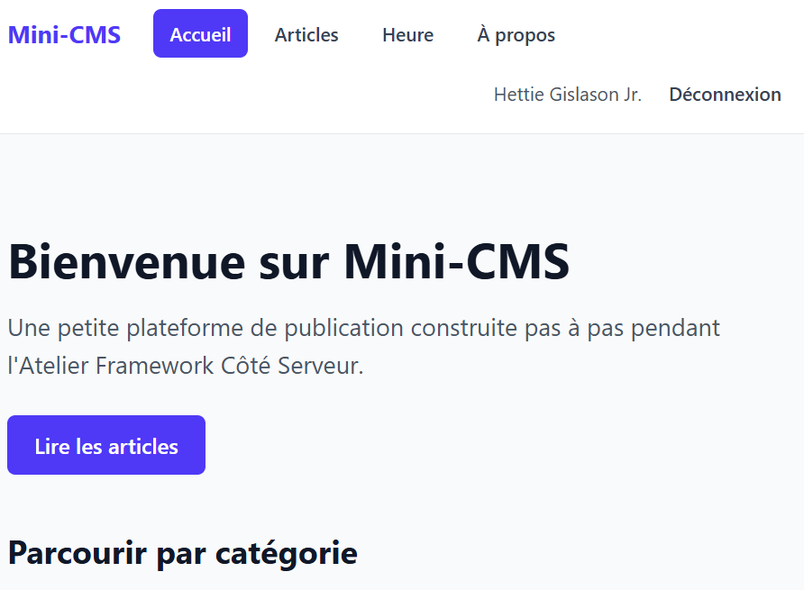

## État actuel (tag lab-06b)

- Middleware `admin` (`App\Http\Middleware\EnsureUserIsAdmin`) sur tout `/admin` : un auteur reçoit 403 « Réservé aux administrateurs. ».
- Gate `manage-tags`, comme `manage-categories` : contrôleur, Form Requests et menu.
- Brouillons protégés : `PostPolicy::view` et le scope `visibleTo` ; un brouillon n'est visible que par son auteur et les administrateurs.
- Tests d'autorisation : `AdminAccessTest` (7 tests) et `PostVisibilityTest` (5 tests), en plus des fichiers de la session 11.
- Comparaison écrite avec le starter kit Livewire (section ci-dessous).
## Comparaison avec le starter kit Livewire

| Critère | Mini-CMS (authentification manuelle) | Starter kit Livewire |
|---|---|---|
| Routes d'authentification | à compléter | à compléter |
| Inscription | à compléter | à compléter |
| Connexion | à compléter | à compléter |
| Déconnexion | à compléter | à compléter |
| Limitation des tentatives | à compléter | à compléter |
| Mot de passe oublié | à compléter | à compléter |
| Vérification de l'e-mail | à compléter | à compléter |
| Double authentification | à compléter | à compléter |
| Rôles et autorisations | à compléter | à compléter |
| Tests | à compléter | à compléter |

Ce que je garderais du kit dans un vrai projet : à compléter (deux phrases).
### Session 12

