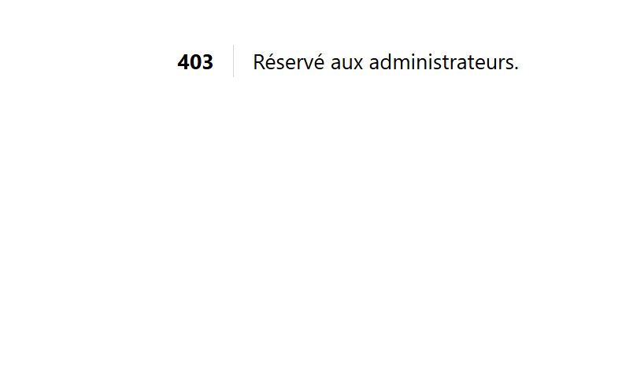
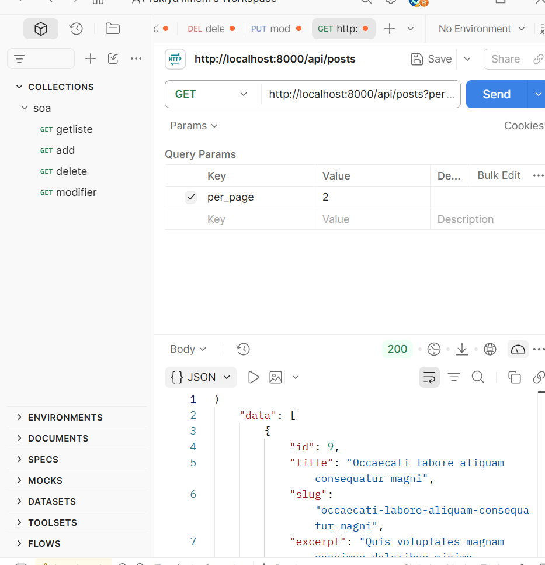

## État actuel (tag lab-07)

- API JSON en lecture seule, installée avec `php artisan install:api` (Sanctum installé ; les jetons arrivent en session 14).
- `GET /api/posts` : articles publiés, paginés (`?per_page=` de 1 à 50, 5 par défaut), avec auteur et catégorie.
- `GET /api/posts/{post}` : un article publié ; un brouillon renvoie 403 et un numéro inconnu 404, en JSON.
- Réponses mises en forme par `PostResource` et `CategoryResource` : ni e-mail ni rôle des auteurs, dates ISO 8601.
- Testée avec Postman et `curl.exe -H "Accept: application/json"`.
## Comparaison avec le starter kit Livewire

| Critère | Mini-CMS (authentification manuelle) | Starter kit Livewire |
|---|---|---|
| Routes d'authentification | à compléter | à compléter |
| Inscription | à compléter | à compléter |
| Connexion | à compléter | à compléter |
| Déconnexion | à compléter | à compléter |
| Limitation des tentatives | à compléter | à compléter |
| Mot de passe oublié | à compléter | à compléter |
| Vérification de l'e-mail | à compléter | à compléter |
| Double authentification | à compléter | à compléter |
| Rôles et autorisations | à compléter | à compléter |
| Tests | à compléter | à compléter |
| GET | `/api/posts` | `api.posts.index` | `Api\PostController@index` |
| GET | `/api/posts/{post}` | `api.posts.show` | `Api\PostController@show` |

Ce que je garderais du kit dans un vrai projet : à compléter (deux phrases).
### Session 12

### Session 13

