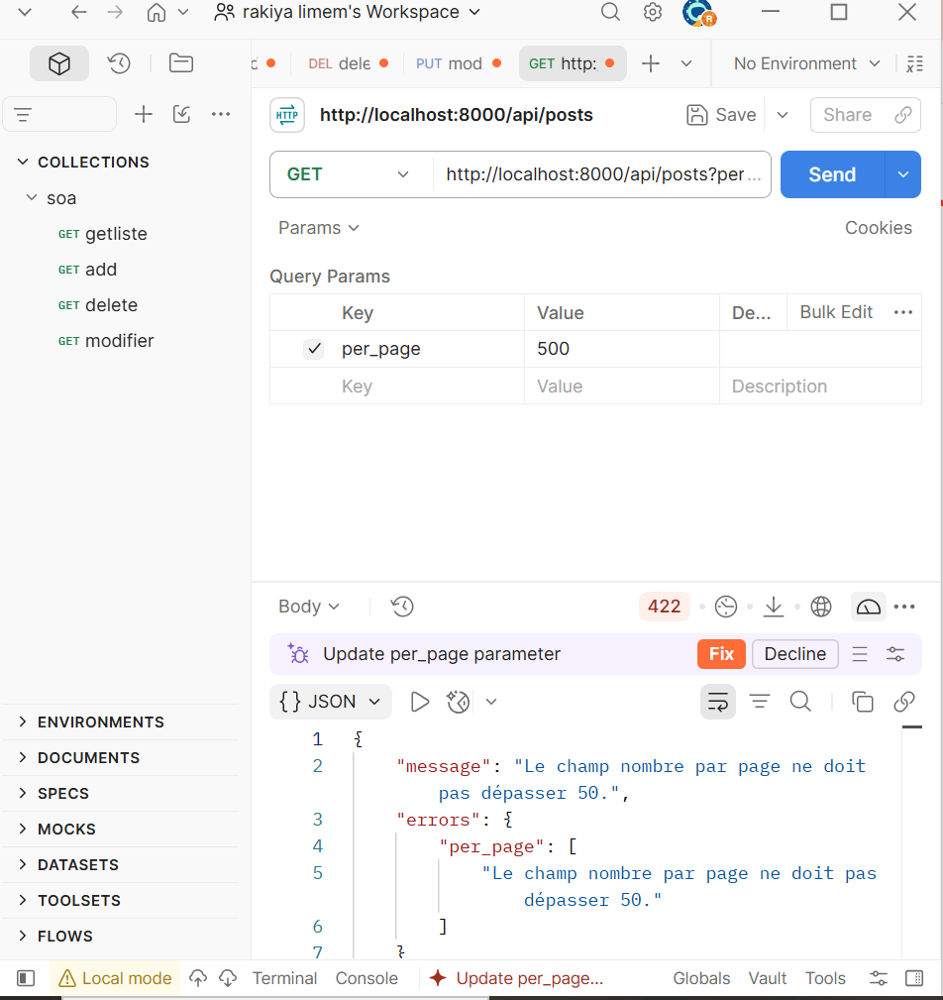
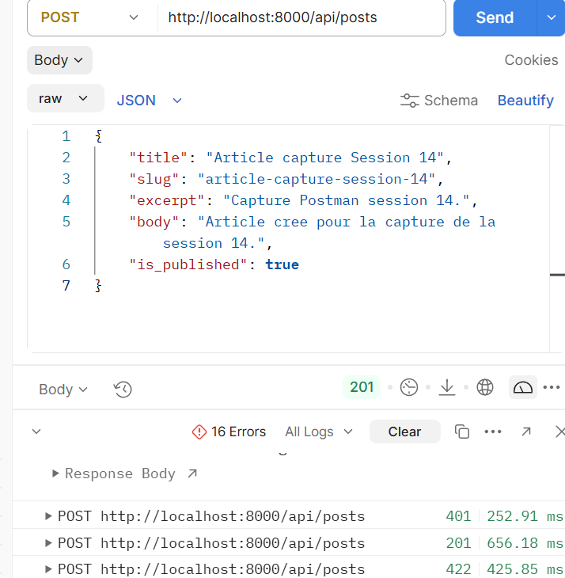
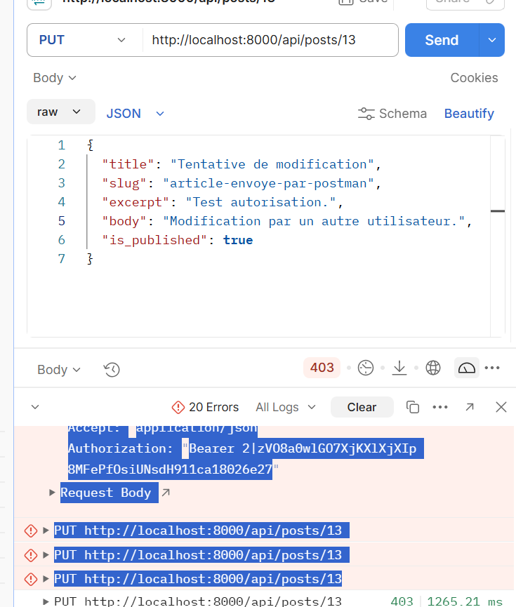

## État actuel (tag lab-08)

- `GET /api/categories` et `GET /api/categories/{category}`, avec le nombre d'articles publiés de chaque catégorie.
- `GET /api/posts?category=<slug>&tag=<slug>` : filtres par catégorie et par tag, comparaison exacte, slug inconnu refusé (422).
- `POST /api/login` renvoie un jeton Sanctum ; `POST /api/logout` le révoque.
- `POST`, `PUT/PATCH` et `DELETE /api/posts` protégés par `auth:sanctum`, avec les mêmes Form Requests et la même `PostPolicy` que le site (401, 403 et 422 en JSON).
- Tests Pest `ApiReadTest` et `ApiWriteTest`.
## Comparaison avec le starter kit Livewire

| Critère | Mini-CMS (authentification manuelle) | Starter kit Livewire |
|---|---|---|
| Routes d'authentification | à compléter | à compléter |
| Inscription | à compléter | à compléter |
| Connexion | à compléter | à compléter |
| Déconnexion | à compléter | à compléter |
| Limitation des tentatives | à compléter | à compléter |
| Mot de passe oublié | à compléter | à compléter |
| Vérification de l'e-mail | à compléter | à compléter |
| Double authentification | à compléter | à compléter |
| Rôles et autorisations | à compléter | à compléter |
| Tests | à compléter | à compléter |
| GET | `/api/posts` | `api.posts.index` | `Api\PostController@index` |
| GET | `/api/posts/{post}` | `api.posts.show` | `Api\PostController@show` |
| GET | `/api/posts` | `api.posts.index` | `Api\PostController@index` |
| GET | `/api/posts/{post}` | `api.posts.show` | `Api\PostController@show` |
| GET | `/api/categories` | `api.categories.index` | `Api\CategoryController@index` |
| GET | `/api/categories/{category}` | `api.categories.show` | `Api\CategoryController@show` |
| POST | `/api/login` | `api.login` | `Api\AuthController@login` |
| POST | `/api/logout` | `api.logout` | `Api\AuthController@logout` |
| POST | `/api/posts` | `api.posts.store` | `Api\PostController@store` |
| PUT/PATCH | `/api/posts/{post}` | `api.posts.update` | `Api\PostController@update` |
| DELETE | `/api/posts/{post}` | `api.posts.destroy` | `Api\PostController@destroy` |

Ce que je garderais du kit dans un vrai projet : à compléter (deux phrases).
### Session 12

### Session 13

### Session 14

